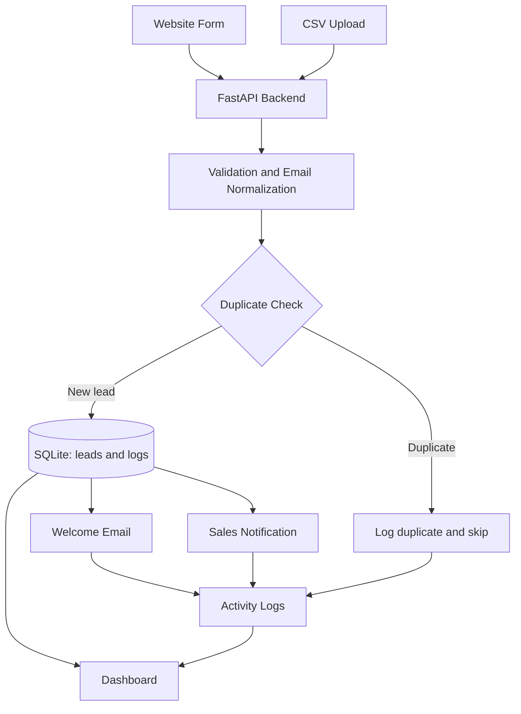

# Architecture

## Processing flow

1. The website form and CSV endpoint both call `process_lead` in `app/crud.py`.
2. Shared validation trims required values and normalizes email to lowercase.
3. SQLite's unique, case-insensitive email constraint provides atomic duplicate protection.
4. A new row and its processing log are saved. SMTP results are logged independently; an unavailable mail server does not roll back lead intake.
5. Dashboard endpoints aggregate lead statuses, sources, duplicate events, and invalid input events from SQLite.

## Main components

- `app/main.py`: application setup, static assets, templates, and router registration.
- `app/routes/`: lead CRUD/import, dashboard statistics, and log APIs.
- `app/crud.py`: shared lead processing and update rules.
- `app/database.py`: SQLite connection, schema initialization, and logging helper.
- `app/email_service.py`: environment-based SMTP delivery with graceful failures.
- `app/templates/` and `app/static/`: server-rendered pages and browser behavior.
